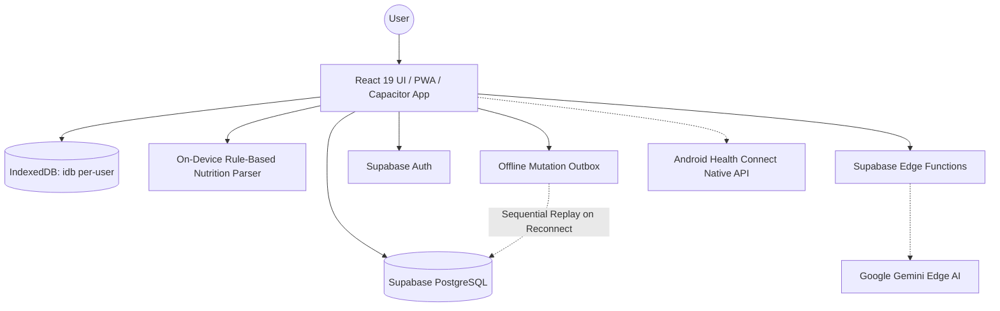

# System Architecture

## Top-Level Architecture (C4 Context)

## Core Architecture Decisions

### Hybrid Edge AI and On-Device Parsing
- **On-Device Grammar Parsing**: Structured nutrition text with explicit macros (calories, protein, carbs, fat, fiber) and single or multi-item blocks is parsed on-device using a deterministic, rule-based parser (`src/lib/nutrition/localParse.ts:42-60` and `supabase/functions/_shared/nutritionParser.ts:1-700`). This completely eliminates network latency, offline barriers, and generative AI token costs for standard inputs.
- **Serverless Edge AI**: Unstructured conversational text, multi-dish descriptions, and photo meal logs are routed to Deno-based Supabase Edge Functions (`supabase/functions/parse-nutrition/index.ts:1-1003`). Running AI processing on the edge offloads intensive multimodal inference while keeping generative AI credentials and service-role secrets securely out of the client app bundle.
- **Database & Auth**: Supabase provides PostgreSQL with fine-grained Row Level Security (RLS) and real-time subscription support.

### Mobile-First with PWA & Capacitor
- The application uses a unified web-first architecture (React 19, Vite, Tailwind CSS v4) configured as an installable Progressive Web App (PWA) with Workbox service worker caching.
- Capacitor wraps the web build for native mobile platforms (Android namespace `fyi.yourbody.app`), enabling direct access to native device layers such as Android Health Connect via Capacitor plugins.

## Offline-First Architecture & Outbox Synchronization

The client provides seamless offline functionality for workout and nutrition tracking via an isolated IndexedDB storage layer and an operation-based mutation outbox:

### Per-User Client Storage
- **Isolated Storage**: Local data is stored in IndexedDB via `idb` (`src/offline/db.ts:1-55`), partitioned strictly by user ID (`yourbody-offline-${userId}`) to guarantee tenant isolation across account switches.
- **Object Stores**:
  - `rq`: Dehydrated React Query cache for instant offline view hydration.
  - `outbox`: Monotonically ordered pending mutation operations (`opId`, indexed by `seq`, `userId`, `state`).
  - `idmap`: Mapping table translating client-generated temporary UUIDs to server-confirmed database UUIDs (`src/offline/idmap.ts`).
  - `meta`: Synchronization checkpoints and sequence tracking counters.
  - `aiq`: Offline AI queue storing pending meal parses with image payloads and capture timestamps (`src/offline/aiQueue.ts:40-120`).

### Outbox Lifecycle and Concurrency
- **Optimistic State Updates**: Mutations update local state and query caches immediately while enqueueing an operation record into the `outbox` store (`src/offline/outbox.ts:28-150`).
- **Cross-Tab Synchronization**: Multi-tab synchronization and execution locking are coordinated via `BroadcastChannel` (`yourbody_outbox_channel`) and Web Locks API (`yourbody-outbox-${userId}`) (`src/offline/outbox.ts:32-35`).
- **Sequential Flusher**: When network connectivity is restored, `flushOutbox` drains pending mutations in sequence order (`src/offline/flusher.ts`), applying operation compaction (`src/offline/compaction.ts`) to merge redundant updates, resolving synthetic IDs via `idmap`, and classifying errors (`src/offline/classify.ts`).
- **Update Safety**: `registerOutboxUpdateBlocker` prevents service worker app updates from reloading while the outbox has uncommitted mutations or an active flush in progress (`src/App.tsx:22`, `src/offline/blocker.ts:1-35`).

## On-Device Nutrition Parser & Confidence Routing

### Shared Rule-Based Parser Core
- The parser core (`supabase/functions/_shared/nutritionParser.ts`) is shared between client-side code (`src/lib/nutrition/localParse.ts`) and edge functions (`supabase/functions/parse-nutrition/index.ts:75-79`).
- Computes confidence scores: `exact` (every line parsed with valid macronutrients and serving details), `lenient` (single-item matches with recoverable macro details), or `partial` (partial matches suitable for manual prefill).

### Parser Modes & Dynamic Routing
- Three configurable parser modes are supported (`src/hooks/useNutritionParserMode.ts:3-12`, stored in localStorage under `yourbody_nutrition_parser_mode`):
  - **`auto` (default)**: Text with `exact` confidence is staged locally on device with zero network calls (`src/components/nutrition/useNutritionAi.ts:269-282`). Ambiguous or non-exact text routes to online Edge AI if online, or falls back to lenient/partial local staging or manual quick log prefill when offline (`src/components/nutrition/useNutritionAi.ts:284-309`).
  - **`always_ai`**: Routes text input to online Edge AI when connected; falls back to on-device parsing when offline (`src/components/nutrition/useNutritionAi.ts:231-268`).
  - **`on_device`**: Exclusively parses on device without invoking serverless Edge AI; falls back to manual entry with prefilled macros if parsing fails (`src/components/nutrition/useNutritionAi.ts:201-230`).
  - **Meal Photos**: Photo analysis always requires network connectivity and online Edge AI execution (`src/components/nutrition/useNutritionAi.ts:199-200, 312-318`).
- **Offline AI Queue**: When offline, meal analysis requests can be queued in the `aiq` IndexedDB store and processed sequentially upon reconnection (`src/offline/aiQueue.ts:40-120`, `src/App.tsx:185-207`).

## Serverless Edge AI Budgets & Model Fallback Chain

Edge AI requests (`supabase/functions/parse-nutrition`) enforce strict execution budgets and bounded fallback chains to prevent client timeouts:

- **Execution Budgets** (`supabase/functions/parse-nutrition/index.ts:8-13`):
  - Overall execution budget: 27 seconds for text (`OVERALL_BUDGET_TEXT_MS = 27000`) and 42 seconds for vision (`OVERALL_BUDGET_VISION_MS = 42000`), deliberately capped below client timeouts (30 s text / 45 s vision in `src/components/nutrition/useNutritionAi.ts`).
  - First attempt timeout cap: 12 seconds for text (`FIRST_ATTEMPT_BUDGET_TEXT_MS = 12000`) and 20 seconds for vision (`FIRST_ATTEMPT_BUDGET_VISION_MS = 20000`), ensuring a slow primary model does not starve the fallback candidate.
  - Minimum attempt budget: 1.5 seconds (`MIN_ATTEMPT_BUDGET_MS = 1500`).
- **Fallback Chain** (`supabase/functions/parse-nutrition/index.ts:34, 641-659`):
  - Bounded to at most `MAX_FALLBACK_MODELS = 2` models.
  - Primary model is `gemini-3.5-flash-lite` (configurable via `GEMINI_MODEL_ID` and `GEMINI_VISION_MODEL_ID`), which fails over to candidate `gemini-3.1-flash-lite` upon timeout or HTTP error.
- **Error & Timeout Telemetry** (`supabase/functions/parse-nutrition/index.ts:53-74`):
  - Timeouts emit Sentry message `parse-nutrition AI timeout`. Model failures emit `parse-nutrition AI model error`.
  - Context includes tags for `model_id`, `attempt_count`, `elapsed_ms`, and `kind` (text or vision), strictly scrubbing user identifiers, email addresses, and prompt contents.

## AI Quota Limits

AI usage is metered and rate-limited via `public.consume_ai_quota` RPC before calling the Gemini API (`supabase/functions/parse-nutrition/index.ts:544-596`):

- **Plan Quotas** (`supabase/migrations/20261012025000_raise_ai_quotas.sql`, `public.app_config.ai_quota_limits`):
  - **Personal (`basic`)**: 20 requests per day.
  - **Coached Athletes (`athlete`)**: 10 requests per day each.
  - **Coach / Coach Pro (`pro`)**: 30 requests per day.
  - **Trial (`trial`)**: 30 requests per day for 14 days.
  - **Free (`free`)**: 0 requests per month.
  - **Photo Multiplier (`photo_cost`)**: 2 quota units per photo meal log.

## Cross-Cutting Concerns

- **Security & Authorization**: Row Level Security (RLS) ensures athletes access only their own records while coaches view assigned athletes. Supabase Edge Functions validate `Authorization` bearer tokens against Supabase Auth.
- **Privacy Guarantee**: Under no circumstances are user IDs, email addresses, meal descriptions, or nutrition values included in telemetry or Sentry error events.
- **Environment Isolation**: Strict boundary separation across client UI, Deno edge functions, and Postgres database.
